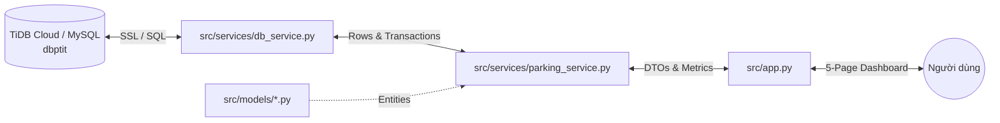

# Architecture

## 1. Kiến trúc phân tầng (Layered Architecture)
Hệ thống tách biệt rõ 3 tầng để đảm bảo khả năng bảo trì, kiểm thử độc lập và an toàn dữ liệu:

1. **Presentation Layer (`src/app.py`):** Giao diện Streamlit 5 trang, nhận thao tác người dùng, định dạng hiển thị và vẽ biểu đồ Altair.
2. **Service Layer (`src/services/parking_service.py`):** Chứa toàn bộ logic nghiệp vụ (`ParkingService`), kiểm tra dữ liệu đầu vào (`ValidationError`), tính phí gửi xe và điều phối transaction.
3. **Data Access Layer (`src/services/db_service.py`):** Quản lý cấu hình (`DBConfig`), kết nối SSL tới TiDB Cloud / MySQL (`DBService`), thực thi truy vấn và transaction (`execute_transaction`).
4. **Domain Models (`src/models/`):** Các `@dataclass` ánh xạ cấu trúc bản ghi của các bảng trong `dbptit`.

## 2. Luồng dữ liệu (Data Flow)

## 3. Database Schema (`dbptit`)
Cơ sở dữ liệu `dbptit` (khởi tạo từ `Dump20261118.sql`) gồm 13 bảng:
- **Danh mục & Hạ tầng:** `baidoxe`, `khuvucdo`, `vitrido`, `loaiphuongtien`, `loaikhachhang`, `banggia`
- **Đối tượng & Thẻ:** `khachhang`, `phuongtien`, `nhanvien`, `thexe`, `vethang`
- **Giao dịch:** `luotdo`, `thanhtoan`

### Quy ước & Ràng buộc quan trọng trong mã nguồn
- `vitrido.trangthai`: `1` = Trống, `0` = Đang có xe đỗ.
- `thexe.trangthai`: `1` = Sẵn sàng cấp phát, `0` = Đang sử dụng.
- `phuongtien.bienso`: tối đa 8 ký tự (`varchar(8) UNIQUE`), tự động chuẩn hóa trước khi lưu.
- `luotdo.giora`: cột `DATETIME NOT NULL`, khi check-in được khởi tạo bằng `giovao` và chỉ cập nhật `NOW()` khi check-out; lượt xe đang gửi được xác định qua điều kiện chưa có bản ghi tương ứng trong `thanhtoan`.
- `thanhtoan.trangthai`: độ dài tối đa 10 ký tự (`varchar(10) NOT NULL`), giá trị chuẩn là `'Thành công'`.
