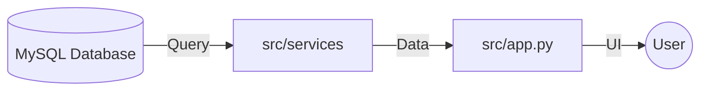

# Architecture

## 1. High-Level Design
Hệ thống sử dụng kiến trúc phân tầng để tách biệt logic xử lý dữ liệu và giao diện người dùng.

## 2. Luồng dữ liệu (Data Flow)

## 3. Database Schema (dbptit)
Hệ thống quản lý dựa trên các bảng: `baidoxe`, `banggia`, `khachhang`, `luotdo`, `thanhtoan`, `thexe`, `vitrido`.
